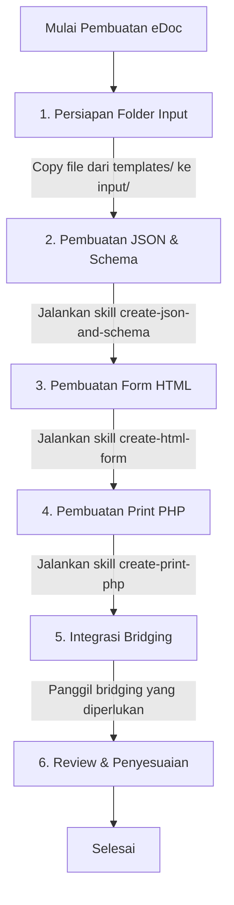

# EDOC GENERATOR — SIMRS Electronic Document System

**EDOC GENERATOR** adalah sistem automasi (*Agent Skill Orchestrator*) yang dirancang untuk memproses referensi dokumen medis (gambar/PDF) atau formulir rumah sakit menjadi **Electronic Documents (eDoc)** yang interaktif dan terintegrasi secara otomatis.

---

## 🎯 Overview (Apa & Mengapa)

Di dalam sistem Edoc, setiap dokumen fisik (seperti form pengkajian pasien, resep, lembar tanda vital, atau form persetujuan) perlu dikonversi menjadi form elektronik interaktif sekaligus dokumen siap cetak (Print/PDF).

Pembuatan dokumen elektronik ini membutuhkan file-file core berikut:
1. Konfigurasi Bridging API SIMRS (`config.json`)
2. Inisialisasi Data Default & Sample (`json.js`)
3. Skema Validasi Data (`schema.json`)
4. Antarmuka Form Input Interaktif berbasis Vue 2 (`index.html`)
5. Layout Dokumen Print/PDF berbasis PHP (`print.php`)

Dengan menggunakan sistem AI Agent, pembuatan dokumen-dokumen ini dapat dilakukan secara bertahap menggunakan *skill* spesifik yang sudah disediakan.

---

## 🔄 Alur Kerja (Workflow) Pembuatan eDoc

Berikut adalah langkah-langkah sistematis (Step-by-Step) untuk menjalankan AI Agent dalam membuat eDoc:



### Penjelasan Langkah-Langkah:

1. **Persiapan Folder Input**
   - Copy semua file yang ada di dalam folder `templates` ke dalam folder `input`. File-file ini akan menjadi dasar dari form HTML dan print PHP yang akan kita buat.

2. **Pembuatan File JSON dan Schema**
   - Berikan prompt kepada AI Agent:
     > "Jalankan `create-json-and-schema`"
   - Agent akan membaca dokumen referensi dan menghasilkan atau memperbarui file `output/json.js` dan `output/schema.json`.

3. **Pembuatan Form HTML**
   - Berikan prompt kepada AI Agent:
     > "Jalankan `create-html-form`"
   - **Tips:** Tambahkan informasi spesifik jika diperlukan. Contoh: *"Jalankan `create-html-form`, pada bagian pilihan agama tolong gunakan komponen dropdown, dan pada bagian keluhan gunakan textarea."*

4. **Pembuatan Print PHP**
   - Berikan prompt kepada AI Agent:
     > "Jalankan `create-print-php`"
   - Agent akan memperbarui file `output/print.php` dengan layout cetak HTML/PHP yang presisi sesuai dengan referensi dokumen tanpa merusak struktur boilerplate.

5. **Integrasi Bridging SIMRS**
   - Panggil bridging satu per satu sesuai dengan kebutuhan dokumen.
   - Referensi bridging dapat dilihat pada file dokumentasi di dalam folder `.agents/skills/bridging-docs`.
   - Ikuti contoh prompting (cara memanggil) yang ada pada file `ztemplate/bridging_anything.md`.

6. **Review & Penyesuaian**
   - Periksa hasil dari file HTML dan PHP yang di-generate.
   - Perbaiki bagian yang kurang sesuai dengan layout asli atau jika ada fungsionalitas/style yang terlewat agar sesuai dengan UI yang diharapkan.

---

## 📁 Struktur Direktori

```text
edoc-generator/
├── .agents/skills/                   # Daftar Skill AI Agent
│   ├── create-json-and-schema/       # Skill untuk generate JSON & Schema
│   ├── create-html-form/             # Skill untuk generate UI Form Vue 2
│   ├── create-print-php/             # Skill untuk generate Layout Print
│   └── bridging-docs/                # Dokumentasi dan Snippet Bridging SIMRS
├── input/                            # Tempat meletakkan file template awal untuk dikerjakan
├── templates/                        # File boilerplate/template dasar (index.html, print.php, dll)
├── ztemplate/                        # Referensi prompt dan guideline (contoh: bridging_anything.md)
└── output/                           # Hasil generasi file dari AI Agent
    ├── config.json
    ├── json.js
    ├── schema.json
    ├── index.html
    └── print.php
```

---

## 📌 Aturan Penting

- **Gunakan Skill yang Tersedia:** Selalu panggil agent menggunakan nama skill yang telah didefinisikan untuk memastikan proses berjalan sesuai standar dan menghasilkan output yang konsisten.
- **Isolasi Output:** Pastikan semua file hasil pekerjaan selalu tersimpan di dalam folder `output/`.
