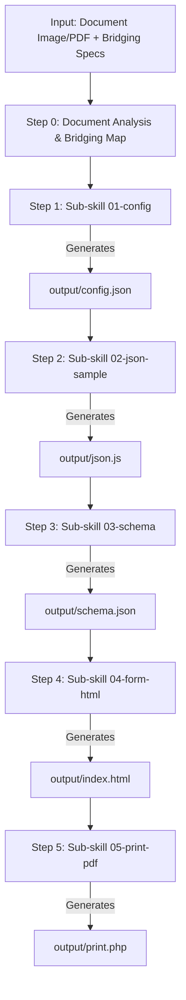

# EDOC GENERATOR — SIMRS Electronic Document System

**EDOC GENERATOR** is a structured automation system (*Agent Skill Orchestrator*) designed to process medical document image/PDF references or hospital forms into fully functional, automatically integrated **SIMRS Electronic Documents (eDoc)**.

---

## 🎯 Overview (What & Why)

In Edoc, every physical paper document (such as patient assessment forms, prescriptions, vital sign sheets, or consent forms) needs to be converted into an interactive electronic form and a print/PDF-ready document.

Building these electronic documents typically requires 5 core components:
1. SIMRS Bridging API Configuration (`config.json`)
2. Default & Mock Sample Data Initialization (`json.js`)
3. Data Validation Schema (`schema.json`)
4. Vue 2 Interactive Input Form Interface (`index.html`)
5. PHP Print/PDF Document Layout (`print.php`)

**EDOC GENERATOR** automates this entire pipeline through 5 independent sub-skill modules executed sequentially by a single *Master Orchestrator*.

---

## 📄 5 Core Output Files (`output/`)

Every time the eDoc Generator runs, it produces 5 files in the `output/` directory:

| File Name | Format | Primary Function |
| :--- | :--- | :--- |
| `config.json` | JSON | Contains the `external_link` configuration defining SIMRS Web Service (`ws`) API endpoints to fetch external data (e.g., patient data, vital signs, attending physicians/DPJP). |
| `json.js` | JavaScript | Provides the `data` object containing `sample` (mock data for testing/preview) and `default` (initial empty state for new documents). |
| `schema.json` | JSON Schema | JSON Schema (Draft-04) used by SIMRS to validate data types and input property hierarchy before saving to the database. |
| `index.html` | HTML/Vue 2 | Vue 2 digital form interface for user data entry, featuring two-way data binding (`v-model`) and integrated SIMRS bridging modals. |
| `print.php` | PHP/HTML | Print/PDF document template replicating the visual layout of the original paper document using dynamic `$params->...` data bindings. |

---

## 🔄 Execution & Pipeline Flow

The eDoc Generator executes step-by-step through a **6-Step Pipeline (Step 0 - Step 5)**:



### Execution Steps Breakdown:

1. **Step 0: Input Analysis & Bridging Mapping**
   - Reads visual document references (images/PDFs located in `images/`).
   - Analyzes form fields (inputs, checkboxes, tables, signature areas).
   - Maps SIMRS bridging requirements based on `resources/bridging_docs/index.json`.

2. **Step 1: Sub-Skill 01-config (`output/config.json`)**
   - Resolves requested bridging modules (e.g., `px_data`, `dokter_dpjp_data`, `vital_sign`).
   - Extracts official API endpoint definitions from bridging documentation without altering endpoint URLs.

3. **Step 2: Sub-Skill 02-json-sample (`output/json.js`)**
   - Establishes the JSON data structure from form analysis and bridging mapping.
   - Constructs the `sample` object (dummy/mock data) and `default` object (initial empty state).
   - Applies *Selective Field Pruning* rules when only partial bridging fields are requested.

4. **Step 3: Sub-Skill 03-schema (`output/schema.json`)**
   - Converts the property hierarchy from `json.js` into an official *JSON Schema Draft-04* specification.

5. **Step 4: Sub-Skill 04-form-html (`output/index.html`)**
   - Uses `template_form.html` boilerplate and UI component standards from `resources/ui_components.md`.
   - Constructs a responsive Vue 2 form interface with two-way bindings (`v-model`).
   - Injects SIMRS bridging modals and data fetching scripts.

6. **Step 5: Sub-Skill 05-print-pdf (`output/print.php`)**
   - Uses `template_print.php` boilerplate.
   - Replicates paper document layout pixel-perceptually with HTML/CSS optimized for PDF printing.
   - Binds dynamic variables using `$params->[key_path]` syntax.

---

## 📁 Repository Structure

```text
edoc-generator/
├── .agents/skills/edoc-generator/     # Agent Skill System Core Directory
│   ├── SKILL.md                          # Master Orchestrator (Pipeline Coordinator)
│   ├── resources/                        # Assets & Reference Specs
│   │   ├── ui_components.md              # UI Design Guidelines & Vue 2 Component Rules
│   │   ├── examples/                     # Integrated eDoc Examples (Few-Shot Reference)
│   │   │   └── [document_name]/
│   │   ├── templates/                    # Base Templates (Boilerplates)
│   │   │   ├── template_form.html        # Vue 2 Form Boilerplate (index.html)
│   │   │   └── template_print.php       # PHP/PDF Print Boilerplate (print.php)
│   │   └── bridging_docs/                # SIMRS Bridging Documentation & Snippets
│   │       ├── index.json                # Bridging Module Directory Map
│   │       └── [module_name].md          # Per-module Config, Modal, & Script Snippets
│   └── subskills/                        # Specialized Sub-Skill Executors
│       ├── 01-config/SKILL.md            # config.json Generator Sub-Skill
│       ├── 02-json-sample/SKILL.md        # json.js Generator Sub-Skill
│       ├── 03-schema/SKILL.md            # schema.json Generator Sub-Skill
│       ├── 04-form-html/SKILL.md         # index.html (Vue 2 Form) Generator Sub-Skill
│       └── 05-print-pdf/SKILL.md         # print.php (Print/PDF) Generator Sub-Skill
├── images/                               # Input Document Image / PDF References
└── output/                               # Pipeline Artifacts Output Directory
    ├── config.json
    ├── json.js
    ├── schema.json
    ├── index.html
    └── print.php
```

---

## 📌 Critical Rules & Core Principles

1. **Zero Snippet Mutation**: Snippets extracted from bridging documentation (`resources/bridging_docs/`) must be injected verbatim without unauthorized modifications.
2. **Selective Field Pruning**: If a user requests a subset of fields from a bridging module (e.g., Vital Signs containing only *Weight* and *Height*), unrequested fields are pruned from `json.js`, `index.html`, and `schema.json`. However, `config.json` must retain the full endpoint URL.
3. **Strict UI Compliance**: All form UI elements generated in Step 4 must adhere to UI design standards defined in `resources/ui_components.md` (e.g., `.card.patient-card` containers, `.form-group`, custom checkboxes, etc.).
4. **Output Isolation**: All generated artifacts must be strictly isolated and saved inside the `output/` directory.

